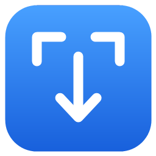
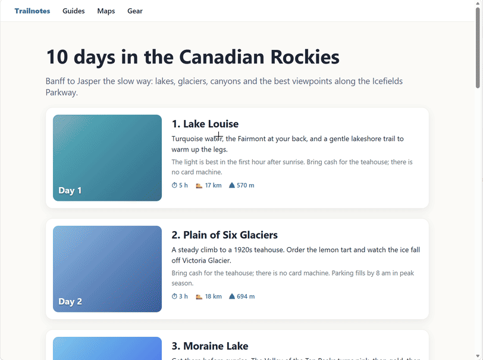
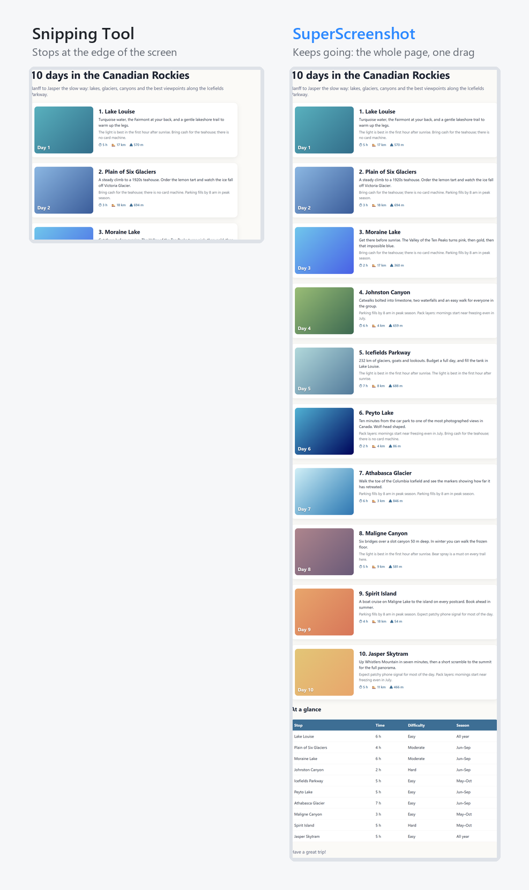

<div align="center">



# SuperScreenshot

## Snipping Tool, with vertical scrolling.

**Drag past the bottom of the screen and the page scrolls with you.**<br>
**Let go, and the whole thing is one screenshot, already on your clipboard.**<br>
**Works in any app that scrolls, not just your browser.**

[](https://github.com/glenwrhodes/SuperScreenshot/releases/latest)

[](https://github.com/glenwrhodes/SuperScreenshot/actions/workflows/ci.yml)
[](https://github.com/glenwrhodes/SuperScreenshot/releases/latest)
[](LICENSE)




</div>

---

## The screenshot you actually wanted

You know the drill. You press **Win+Shift+S**, drag over the thing you need... and it's
taller than your screen. So you take three screenshots, or you shrink the page to 50% until
nothing is readable, or you give up and paste a link.

**SuperScreenshot is the Snipping Tool you already know, with one superpower: it scrolls.**

Press **Win+Shift+X**, start dragging, and keep going. Hit the bottom of the window and the
page scrolls under your selection, faster the further you push. Or just turn the mouse wheel
while you hold the button. The top of your selection slides up off the screen, the size label
keeps counting, and when you let go you get **one clean, seamless, full-resolution image**.

And it isn't a browser extension. It works from what's on the screen, so it scrolls and
stitches **anything with a scroll bar**: web pages, File Explorer folders, terminal output,
documents, chat history, settings pages.

<div align="center">

</div>

## Features

- 🖱️ **Feels like Snipping Tool.** Dimmed screen, crosshair, drag a box, done. Nothing new to learn.
- 📜 **Vertical scrolling capture.** Drag to the bottom (or top) edge to auto-scroll, or use the mouse wheel mid-drag. Scroll down, back up, down again: it keeps track.
- 🪟 **Any app, not just the browser.** It works from pixels, not from a web page's code: any browser, File Explorer, terminals, documents. If it scrolls with the mouse wheel, it can capture it.
- 🧵 **Seamless stitching.** No doubled lines, no seams, and sticky headers, sticky footers and the browser's own toolbar aren't repeated down the page.
- 📋 **Straight to the clipboard.** Paste into Slack, Teams, email, Word, GitHub, anywhere. Or save as PNG or JPEG.
- ⌨️ **Win+Shift+X, anywhere.** One key over from Snipping Tool's Win+Shift+S. Lives quietly in the hidden icons tray and starts with Windows.
- 🔍 **Pixel perfect.** Per-monitor DPI aware: full resolution and crisp at 100%, 150% or 200% scaling.
- 🪶 **Small and private.** One process, no account, no cloud, no telemetry. It never touches the network.
- 🆓 **Free and open source** (MIT).

## SuperScreenshot vs. Snipping Tool

| | Snipping Tool | **SuperScreenshot** |
| --- | :---: | :---: |
| Drag to select a region | ✅ | ✅ |
| Copies to the clipboard automatically | ✅ | ✅ |
| Global shortcut | Win+Shift+S | **Win+Shift+X** |
| **Capture more than fits on the screen** | ❌ | ✅ |
| **Auto-scroll when you drag past the edge** | ❌ | ✅ |
| **Scroll with the mouse wheel while selecting** | ❌ | ✅ |
| Stitches a tall page into one image | ❌ | ✅ |
| **Scrolling capture in any app, not just a browser** | ❌ | ✅ |
| Open source | ❌ | ✅ |

## Install

1. Download **`SuperScreenshot-Setup-<version>-x64.exe`** from the
   [latest release](https://github.com/glenwrhodes/SuperScreenshot/releases/latest).
2. Run it. It installs just for you, so it doesn't ask for admin rights. Choose "all users"
   on the first page if you want it in Program Files instead.
3. Press **Win+Shift+X**. That's it.

You get a Start menu entry, an entry in **Settings → Apps → Installed apps** for a clean
uninstall, and SuperScreenshot starts with Windows. You can turn that off from the tray icon.

Prefer no installer? Grab **`SuperScreenshot-<version>-portable-x64.zip`**. It's a single
`.exe` that runs from anywhere, with nothing else to install: the .NET runtime is built in.

> **"Windows protected your PC"?** The installer isn't code-signed yet, so SmartScreen may
> warn you the first time. Click **More info → Run anyway**. Every release is built from this
> repository's source by [GitHub Actions](https://github.com/glenwrhodes/SuperScreenshot/actions).

Requires Windows 10 version 2004 or later, or Windows 11 (64-bit).

## How to use it

| To | Do this |
| --- | --- |
| Take a screenshot | **Win+Shift+X**, or click the tray icon, then drag |
| Capture more than fits on screen | Keep dragging into the bottom edge, or **turn the mouse wheel** while holding the button |
| Scroll faster | Push further into the edge, or past it (onto the taskbar is fine) |
| Go back up | Drag to the top edge, or wheel up |
| Cancel | **Esc** or right-click |
| Copy / save again | **Copy** and **Save…** in the preview window (Ctrl+C, Ctrl+S) |
| Exit, or stop it starting with Windows | Right-click the tray icon |

It works on anything that scrolls vertically with the mouse wheel, in any app: web pages in
any browser, File Explorer folders, terminal output, documents, chat history.

## FAQ

**Why Win+Shift+X and not Win+Shift+S?**
Win+Shift+S belongs to Windows itself, and other apps can't take it. Win+Shift+X is free,
it's right next door, and X marks the spot.

**Why does it run in the tray? Snipping Tool doesn't.**
Snipping Tool cheats: Windows owns its shortcut and launches it for it. No other app gets
that privilege, so SuperScreenshot keeps one small process running to listen for Win+Shift+X,
the same as ShareX, Greenshot and PowerToys do.

**What about sticky headers, cookie banners and chat bubbles?**
Things that stay put while the page scrolls are recognised and not repeated. Each part of the
page is taken from the moment it was nearest the middle of the window, away from overlays
pinned to the edges. Anything still on screen at the very start or end, like a chat bubble
pinned to the corner, stays in the shot, because it's part of what you selected.

**Does it scroll sideways?**
Not yet: vertical only, up to 30,000 px tall.

**Is anything uploaded?**
No. SuperScreenshot never uses the network. Your screenshot goes to your clipboard and, if
you save it, to a file you choose.

## How it works

- **The screen isn't frozen.** Snipping Tool shows a still picture of the screen. SuperScreenshot
  instead puts a dim overlay over the live screen. The overlay is click-through and hidden from
  screen capture (`WDA_EXCLUDEFROMCAPTURE`), so the page underneath can scroll, and screenshots
  never include the overlay.
- **Input:** low-level mouse and keyboard hooks, on their own thread so the mouse never lags,
  take the clicks, Esc and the wheel. While you drag, every wheel turn goes to the page where you
  started: the cursor hops there and back in a single `SendInput` call.
- **Tracking** (`Tracker.cs`): about 30 times a second it grabs the window and hashes every row,
  in vertical bands so a fixed sidebar can't spoil a match. Changed rows vote on how far the
  content moved, and the shift with the most votes wins. Rows that stay still while everything
  else moves are a sticky header, sticky footer or toolbar.
- **Stitching:** each row of the final image comes from the frame where that row was nearest
  the middle of the window. At the edges, rows may not be drawn yet, or come from a frame
  caught mid-redraw, and see-through headers and floating bubbles sit there. When you let go,
  it waits for the page to stop moving, so the last rows are fully drawn.

## Building from source

Needs the [.NET 9 SDK](https://dotnet.microsoft.com/download/dotnet/9.0). The installer also
needs [Inno Setup 6](https://jrsoftware.org/isinfo.php).

```powershell
dotnet build                          # debug build
dotnet test                           # stitching tests on synthetic pages
.\publish.ps1                         # tests, then dist\SuperScreenshot.exe (self-contained, single file)
.\publish.ps1 -Installer              # ...and dist\installer\SuperScreenshot-Setup-<version>-x64.exe
.\publish.ps1 -TestInstaller          # ...then installs it silently, checks it, and uninstalls it
```

CI (`.github/workflows/ci.yml`) runs all of that on every push. Pushing a `v*` tag attaches the
installer and the portable zip to a GitHub release.

### Developer switches

- `SuperScreenshot.exe --scroll-test X Y NOTCHES OUT.png` tracks the window under (X, Y), turns
  the wheel there, and saves what it stitched, with a log at `OUT.png.txt`.
- `SUPERSCREENSHOT_SHOW_OVERLAY=1` lets screenshots see the overlay, to check how it looks.
  Scrolling capture can't work in that mode.
- `SUPERSCREENSHOT_LOG=C:\path\trace.log` writes a trace.
- `SuperScreenshot.exe --exit` closes the running copy. The uninstaller uses it.

### Code map

| File | What it does |
| --- | --- |
| `TrayApp.cs` | Tray icon and menu, start with Windows, the hotkey |
| `GlobalHotkey.cs` | Registers Win+Shift+X |
| `MainForm.cs` | The preview window: New / Copy / Save |
| `CaptureSession.cs` | One capture: overlay, selection, auto-scroll, wheel redirect |
| `Tracker.cs` | Follows the scrolling and stitches the tall image |
| `Overlay.cs` | Layered overlay window, input hook thread, crosshair cursors |
| `ScreenHelpers.cs` | Window under a point, DPI, injecting wheel turns |
| `Pixels.cs` | Screen grabbing and bitmap building |
| `packaging/windows/superscreenshot.iss` | The Inno Setup installer |
| `tests/` | Stitching tests, and the installer test CI runs |

## Contributing

Issues and pull requests are welcome. If a page doesn't stitch cleanly, please open an issue
with the page (or one like it) and what you saw. `--scroll-test` output is a big help.

## License

[MIT](LICENSE) © 2026 Glen Rhodes
